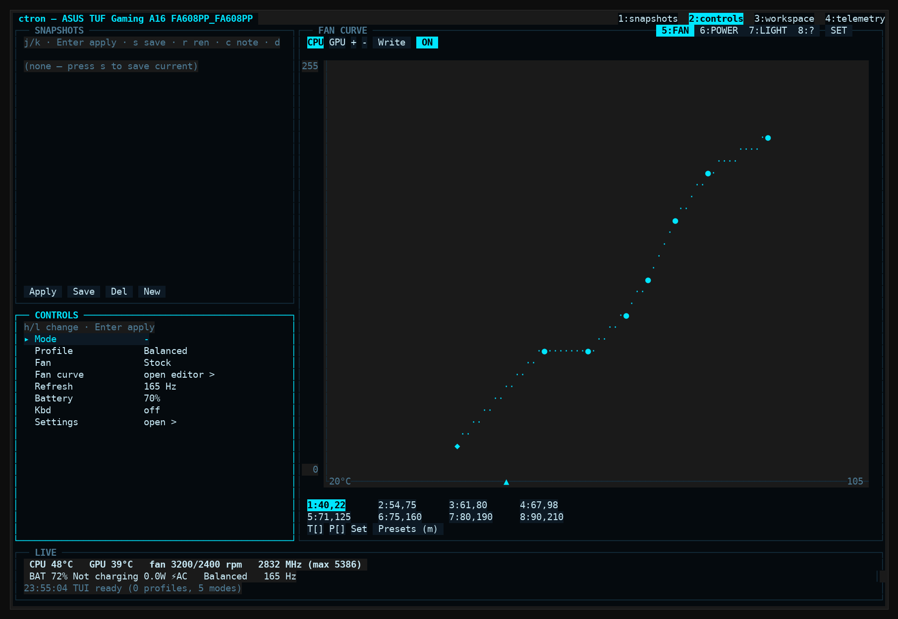
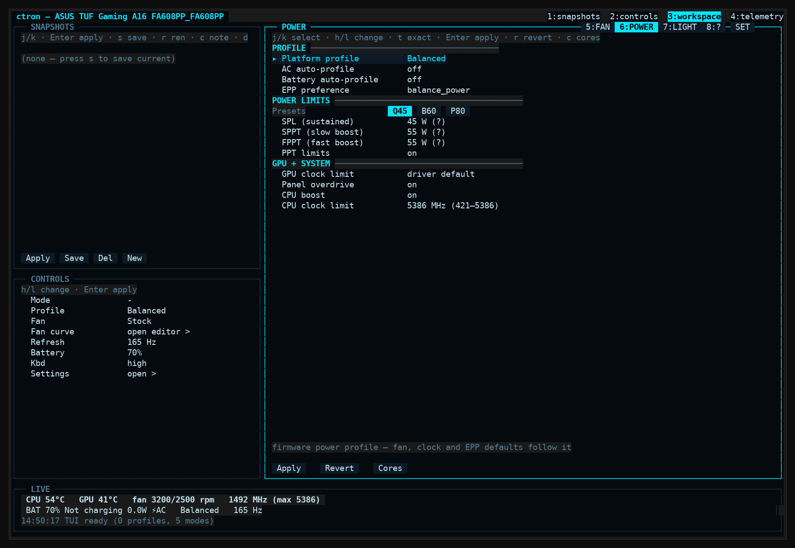
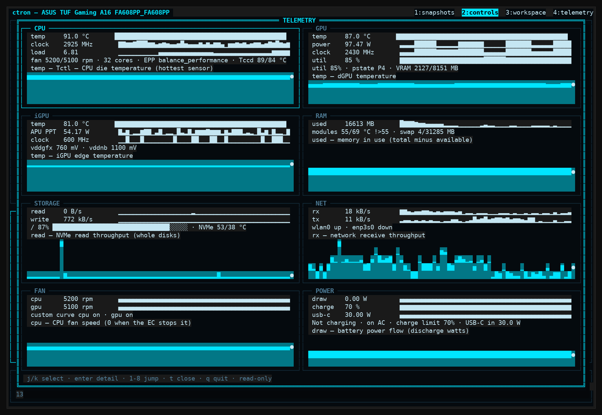

<div align="center">

# ctron

**Lightweight ASUS laptop control center for Linux.**

One C binary. One dependency ([notcurses](https://github.com/dankamongmen/notcurses)). No daemon.


</div>

**No arguments** → fullscreen TUI in your current terminal. **Any
argument** → headless CLI: does the job, exits. Script/ssh friendly —
piped output never opens the TUI.



## What it does

| Area | What you get |
| --- | --- |
| **Fans** | Dual 8-point CPU/GPU curves with a live graph editor, built-in Quiet / Balanced / Performance presets, per-fan on/off, EC write with read-back verification |
| **Power** | Platform profiles, EPP, PPT watt limits (asus-armoury or ryzenadj), per-core / per-CCD / all-thread frequency ceilings, GPU core-clock lock, NVIDIA dynamic boost & temp target |
| **Battery** | Charge limit (20–100 %), one-shot charge-to-full |
| **Display** | Refresh-rate control via compositor backends (KDE, Hyprland), panel overdrive |
| **Lighting** | Keyboard backlight, AURA effects, optional daeboard LED daemon control + binds editor |
| **Automation** | Shortcut modes (`modes.ini`), hardware snapshots (save / rename / note / apply / export) |
| **Telemetry** | Temps, fan RPM, frequencies, watts, network rx/tx, battery — live in the TUI, one line under `--watch` |

Working principles, enforced in code:

- Every write is a **user action** — nothing is ever written from the poll loop.
- Writes are **verified by reading back** (kscreen-doctor and Hyprland both exit 0 without applying).
- Unknown reads print `--`, never fabricated fallback data.

Verified on an **ASUS TUF Gaming A16 FA608PP** (Ryzen 9 8940HX + RTX 5070
Max-Q, CachyOS, KDE Plasma Wayland, kernel 7.2) and a **TUF A15
FA507NVR** (Ryzen 7 7435HS + RTX 4060, NixOS, Hyprland 0.55) — same
picture with two kernel-related exceptions. Support beyond these
machines depends on the ASUS WMI stack, CPU vendor, NVIDIA driver and
compositor; the row-by-row breakdown lives in
[HARDWARE.md](HARDWARE.md) (English + Türkçe).

## Build & install

```bash
# Arch          sudo pacman -S base-devel notcurses
# Fedora        sudo dnf install gcc make pkgconf notcurses-devel
# Debian/Ubuntu sudo apt install build-essential pkg-config libnotcurses-dev
# Nix           nix-shell -p gcc pkg-config notcurses gnumake
make
./build/ctron --status
```

`make install` copies the binary to `~/.local/bin/ctron` (plus the
`ctron-toggle` helper — see [the M4 key section](#kde-armoury-crate-m4-key)).

Runtime tools are probed, never linked: `asusctl`, `nvidia-smi`,
`ryzenadj`, `kscreen-doctor` / `hyprctl`. Missing ones simply grey out
their rows.

## Quick start (Türkçe)

```bash
ctron                    # tam ekran arayüz (TUI)
ctron --status           # tüm donanım durumunu yaz, çık
ctron --watch            # canlı tek satır telemetri (Ctrl-C durdurur)
ctron --doctor           # neler destekleniyor raporu
ctron --mode turbo       # hazır ayar paketi uygula
ctron mode list          # paketleri listele (modes.ini)
ctron --profile quiet    # tekil komutlar da çalışır
ctron --battery 80
```

## The TUI

| Key | Action |
| --- | --- |
| `1`–`4` | focus a panel — snapshots · controls · workspace · telemetry |
| `5`–`8` | workspace view from anywhere — fan · power · light · help |
| `j` / `k` | navigate · `h` / `l` change the value |
| `Enter` | apply · `w` write staged values · `r` revert staging |
| `ESC` | settings overlay — panel layout is adjustable live |
| `?` | help · `q` quit |

Rows are clickable (mouse is a known gap under Hyprland — see the
[handoff notes](#display-backends-compositor-refresh-rate-control)).
Per-view keys (fan point editing, presets modal, core-limit overlay)
are listed in the HELP view and the footer while you use them.

`t` opens a **fullscreen read-only telemetry screen**: eight live
sections (CPU / GPU / iGPU / RAM / storage / network / fans / power),
each with rolling wash-fill charts over a ~60 s window — CPU & GPU
temperatures, clocks, load, fan RPMs, dGPU power/utilisation/VRAM,
iGPU temp/clock/power, RAM use + module temps, NVMe temps + disk I/O +
fill bar, per-interface network rx/tx, battery draw/charge.
`j`/`k` walk the section grid and `Enter` (or `1`–`8`) opens a
section's **detail page**: full-width multi-row charts with min/max/last
stats plus info lines from a fresh live snapshot (PPT/EPP, per-core
ceilings, GPU pstate & throttle reasons, VRAM/clock lock, battery
health …); `h`/`l` flips sections, `esc` backs out to the grid.
Unknown sensors stay `--`; the screen never writes hardware.




## CLI reference

The everyday surface:

```bash
ctron --hz 165                    # display refresh
ctron --fan-curve cpu 40,60,80 80,140,220
ctron --fan cpu on                # custom curve on that fan
ctron --ppt Q45                   # quick presets, or B60 / P80
ctron --ppt 45,35,54              # explicit SPL,SPPT,FPPT (W)
ctron --gpu-clock 1400            # NVIDIA core-clock lock
ctron --freq ccd 1 3500           # per-CCD ceiling (or: core 4 5386)
ctron --battery-oneshot           # charge to full once
```

<details>
<summary><b>Full flag list</b> (<code>ctron --help</code>)</summary>

```
Usage: ctron [flags] | ctron mode <sub> | ctron snapshot <sub>

No arguments opens the fullscreen TUI (needs a terminal).

Information:
  --status, -s        live hardware snapshot
  --watch, -w         rolling one-line telemetry (Ctrl-C stops)
  --doctor            capability report
  --help, -h          this help
  --version, -V       version

Modes & snapshots:
  --mode <name>       apply a shortcut bundle (see modes.ini)
  mode list|show <n>|add <name> <steps>|delete <n>
  snapshot list   (alias: profile)
  snapshot apply|export|delete <name>

Hardware (key = value pairs, same as mode steps):
  --profile quiet|balanced|performance
  --ac-profile off|quiet|balanced|performance
  --battery-profile off|quiet|balanced|performance
  --epp power|balance_power|balance_performance|performance
  --freq <mhz>                 every thread
  --freq core <cpu-id> <mhz>   one thread (kernel id)
  --freq ccd <n> <mhz>         every thread in that CCD
  --hz <rate|max>         display refresh (compositor backend)
  --battery <20..100>     charge limit
  --battery-oneshot       charge to full once
  --ppt Q45|B60|P80|<spl>,<sppt>,<fppt>|off|on
  --nv-boost <5..25 W>    NVIDIA dynamic boost
  --nv-temp <75..87 C>    NVIDIA temp target
  --gpu-clock <mhz>|reset NVIDIA core-clock lock
  --panel-od on|off       panel overdrive
  --cpu-boost on|off      cpufreq boost
  --kbd off|low|med|high  keyboard backlight
  --follow            run ctron actions from daeboard binds
  --daeboard-start    start the daemon (sudo -n systemd-run)
  --daeboard-stop     ask the daemon to quit
  --daeboard-reload   recompile ~/.config/ctron/daeboard.binds
  --aura <effect> [color|hex]
  --fan stock|silent|cool|full|on|off|cpu on|cpu off|gpu on|gpu off
  --fan-curve cpu|gpu <temps> <pwms>
  --fan-write             write in-memory curve to the EC

Config: ctron [--config-dir DIR]
```

</details>

Modes ("CLI shortcuts") live in `~/.config/ctron/modes.ini` and can be
edited from the TUI (**ESC → CLI SHORTCUTS**) or with `ctron mode add`:

```ini
[turbo]
steps = profile performance, ppt P80, fan cool, hz max
```

PPT notes: on locked-PPT laptops writing needs `ryzenadj` (the sudoers
rule must name the literal path, e.g. `/usr/bin/ryzenadj`), and SMU
limits are **volatile** — re-apply after reboot / profile changes.
`--gpu-clock` similarly needs sudoers for `nvidia-smi`. See
[SECURITY.md](SECURITY.md) for the privilege model and recommended
sudoers rules.

## Writing to hardware — the privilege model

Every write is a user action (nothing is written from the poll loop)
and goes through one chain:

1. **asusctl** when installed (no root needed),
2. else a **direct sysfs write** (works where the node is writable),
3. else `sudo -n` — passwordless sudo only; without it you get a clean
   error in the log, never a password prompt or a hang.

PPT limits come from the `asus-armoury` firmware-attribute `min`/`max`
files when the firmware exposes them; otherwise a generous physical
ceiling is used and kernel rejections are surfaced. Values reported as
`0`/`5` by the stale kernel cache are printed as `--` (unknown), never
faked.

<details>
<summary><b>Display backends</b> (compositor refresh-rate control)</summary>

```c
typedef struct display_ops {
    const char *name;
    bool (*detect)(void);
    int  (*current_hz)(void);
    int  (*modes_hz)(int *out, int max);
    int  (*set_hz)(int hz);
} display_ops_t;
```

- `display_kde.c` — **complete**, verified on KDE Plasma (kscreen-doctor).
- `display_hypr.c` — **Hyprland handoff** (see below).
- Adding one = a new file implementing the struct + one line in
  `display.c`'s registry. `DISPLAY_BACKEND=<name>` forces a backend.

Hyprland handoff state:

- [x] detect via `HYPRLAND_INSTANCE_SIGNATURE` + `hyprctl monitors -j`
- [x] JSON is a **raw array** (no `"monitors"` wrapper, no `currentMode`);
      parse top-level `name` / `width` / `height` / `refreshRate` on the
      focused output. Verified Hyprland **0.55.4** on FA507NVR (NixOS).
- [x] `availableModes` (`60` / `144` on the TUF panel)
- [x] `set_hz` via `hyprctl eval 'hl.monitor({...})'` (0.55 Lua parser;
      `keyword monitor` is a no-op). Position and scale copied from JSON.
      Fallback: legacy `hyprctl keyword monitor`.
- [ ] HDMI-A-1 / multi-monitor: only the focused output is changed.
- [ ] TUI mouse under Hyprland (v1 edge-tab history).

</details>

<details>
<summary><b>KDE: Armoury Crate (M4) key</b></summary>

The TUF's M4 key emits `KEY_PROG3` → XKB `XF86Launch3`; KDE's shortcut
picker shows it as **"Launch (3)"**. Bind ctron to it under
**System Settings → Keyboard → Shortcuts → Add New → Command or
Script**:

```
Name:    ctron
Command: ctron-toggle           # installed by `make install`
```

`ctron-toggle` gives the key open/close behaviour: a running ctron is
closed (the `konsole -e` window ends with it), none running means one
opens. Without it every key press would spawn another window — a
desktop shortcut only spawns, it has no toggle sense. The script
honours `$TERMINAL` and falls back to `konsole`; point a `.desktop`
`Exec` at it just the same. **A service shortcut launches the command
kglobalaccel cached at session start — changing the `.desktop` `Exec`
takes effect only after the next re-login.** Independently of the
launcher, the fullscreen TUI is single-instance: a second ctron bows
out with "already running" instead of stacking windows.

If the capture dialog refuses the key, read its real code with
`sudo evtest /dev/input/event11` ("Asus WMI hotkeys"; XKB keycodes are
the Linux input code + 8). The binding lives entirely in KDE — ctron
itself never listens for the key (it is a TUI/CLI, not a daemon).

</details>

<details>
<summary><b>Layout of the code</b></summary>

```
src/
  util.c        sysfs/exec/log helpers (single place for privilege writes)
  hw.c          read layer: fast poll (temp/RPM/battery) + full snapshot
  control.c     write layer: profile/EPP/PPT/battery/fan/kbd/Hz
  cmds.c        key/value command table shared by CLI, modes and profiles
  fan.c         8-point fan curve model (pure, unit-tested)
  modes.c       user shortcut bundles (modes.ini)
  profile.c     snapshots (.ctr files, free-form names)
  settings.c    prefs + hardware persistence
  ui/           fullscreen TUI: layout engine + independent panels
  display/      compositor backends (see above)
tests/          unit tests (make test)
```

</details>

## Roadmap (parked)

Open work is tracked in [NEXT.md](NEXT.md) (single source). Intentionally
parked: Waybar color sync · MUX / dGPU switch (needs a reboot flow) ·
`throttle_thermal_policy` (overlaps platform profiles) · wlr-randr /
xrandr backends · UI language table (EN/TR) · polkit helper ( SECURITY.md
Phase 3) · per-key keyboard color (single-zone keyboard).

## Documentation

| Doc | What's in it |
| --- | --- |
| [HARDWARE.md](HARDWARE.md) | row-by-row support matrix (English + Türkçe) |
| [SECURITY.md](SECURITY.md) | privilege model, hardening roadmap |
| [CHANGELOG.md](CHANGELOG.md) | what changed, when |
| [NEXT.md](NEXT.md) | roadmap — the single source of open work |
| [PLAN.md](PLAN.md) / [PLANS.md](PLANS.md) | the approved v2 plan & shipped plans |
| [HANDOFF.md](HANDOFF.md) / [AGENTS.md](AGENTS.md) | session records & agent guidelines |

Config lives in `~/.config/ctron/` (`settings.ini`, `modes.ini`,
`profiles/*.ctr` snapshots); the TUI footer keeps a ring buffer of the
last 24 actions.
